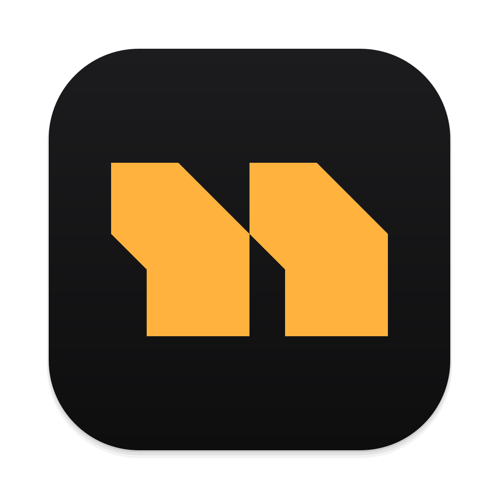
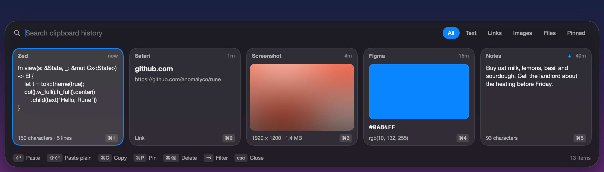
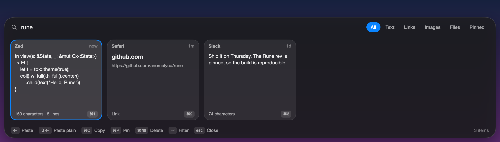
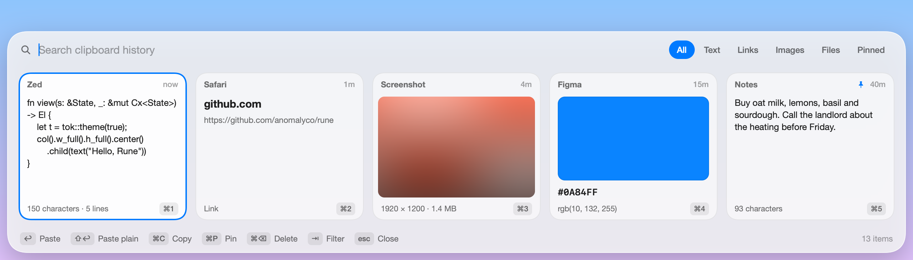

<p align="center">
  
</p>

<h1 align="center">Nerda Clipboard</h1>

<p align="center">
  <strong>Clipboard history for the Mac, on a glass shelf.</strong><br>
  Press ⇧⌘V, pick what you copied earlier, and it is pasted into the app you were in.
</p>

<p align="center">
  <a href="https://github.com/kamafozilov/nerda.clipboard/releases/latest"></a>
  
  
  <a href="LICENSE"></a>
</p>

<p align="center">
  <a href="https://github.com/kamafozilov/nerda.clipboard/releases/latest/download/NerdaClipboard.dmg"><strong>Download for macOS</strong></a>
  &nbsp;·&nbsp;
  <a href="#what-it-keeps">What it keeps</a>
  &nbsp;·&nbsp;
  <a href="#keys">Keys</a>
  &nbsp;·&nbsp;
  <a href="#build-it-yourself">Build it yourself</a>
</p>

<br>



<br>

Nerda Clipboard remembers what you copy: text, links, images, files and colours. The shelf rises from the bottom of the display your pointer is on, and everything on it is reachable from the keyboard. It is a native app written in Rust with [Rune](https://github.com/anomalyco/rune), a **14 MB download** with no account and no telemetry: the history is a file on your Mac.

<table>
  <tr>
    <td width="33%" valign="top"><b>🪶 Light</b><br>Only the cards in view are built, so the shelf is as quick with 5,000 entries as with 100.</td>
    <td width="33%" valign="top"><b>🔒 Private</b><br>Nothing leaves your Mac. Passwords from password managers are never recorded.</td>
    <td width="33%" valign="top"><b>⌨️ Keyboard first</b><br>Type to search, arrows to move, ↩ to paste, ⌘1 to ⌘9 for the newest nine.</td>
  </tr>
</table>

## Install

1. Download [NerdaClipboard.dmg](https://github.com/kamafozilov/nerda.clipboard/releases/latest/download/NerdaClipboard.dmg), open it and drag Nerda Clipboard onto Applications.
2. Open it from Applications. The first time, macOS says it can't check the app: open System Settings › Privacy & Security, scroll down and click **Open Anyway**. This is asked once.
3. Press ⇧⌘V. The first paste asks for **Accessibility** access, which is how the app presses ⌘V for you. Until you allow it, the entry is put on the clipboard and you press ⌘V yourself.

The app lives in the menu bar, with Pause Recording, Clear History, Show Data Folder and Quit. Every release is signed with the same certificate, so macOS keeps the Accessibility permission across updates.

## What it keeps

<table>
  <tr>
    <td width="50%"><br><b>Search</b> by typing. Tab switches between All, Text, Links, Images, Files and Pinned.</td>
    <td width="50%"><br><b>Light and dark</b>, on Liquid Glass on macOS 26 and frosted vibrancy before it.</td>
  </tr>
</table>

- **Text**, with its rich forms (RTF and HTML), so formatting survives a paste. ⇧↩ pastes it plain.
- **Links**, shown by their host.
- **Images** from any app, stored as PNG, with a thumbnail and their size.
- **Files and folders** copied in Finder. A single image file gets a thumbnail.
- **Colours** (`#rgb`, `#rrggbb`, `#rrggbbaa`, `rgb()`, `rgba()`), shown as a swatch.

Copying the same thing again moves its card to the front instead of making a second one. **Pinned** entries stay for good; the rest are trimmed to the newest 200 entries and 256 MB of images, both of which you can change.

Never recorded: copies that password managers mark as private (the [nspasteboard.org](http://nspasteboard.org) markers), and anything copied in the apps listed in `ignored_apps`, which starts with Keychain Access, Passwords, 1Password and Bitwarden.

## Keys

| Key | Action |
| --- | --- |
| ⇧⌘V | Open or close the shelf (global) |
| ← → | Move between cards (⌘← ⌘→ jump to the ends) |
| ↩ | Paste the selected entry |
| ⇧↩ | Paste it as plain text |
| ⌘1 … ⌘9 | Paste the first nine entries directly |
| ⌘C | Copy the entry without pasting |
| ⌘P | Pin or unpin (pinned entries are never trimmed) |
| ⌘⌫ | Delete the entry |
| ⇥ / ⇧⇥ | Switch filter: All, Text, Links, Images, Files, Pinned |
| esc | Clear the search, then close |

A click selects a card and a double click pastes it.

## Settings

`~/Library/Application Support/nerda.clipboard/config.json`, read at launch:

```json
{
  "shortcut": "cmd+shift+v",
  "max_items": 200,
  "max_image_mb": 256,
  "ignored_apps": ["com.apple.keychainaccess", "com.apple.Passwords", "com.1password.1password", "com.bitwarden.desktop"],
  "material": "glass"
}
```

`max_items` is how many unpinned entries are kept, and `max_image_mb` how much copied image
data; past either, the oldest unpinned entries go. Pinned entries always stay.

`material` is `glass` (Liquid Glass on macOS 26 and later) or `popover` (frosted vibrancy).
The history lives beside it in `history.db`, with thumbnails in `thumbs/`.

## Build it yourself

You need a Mac with Apple silicon, Xcode's command line tools and [Rust](https://rustup.rs).

```sh
scripts/bundle.sh --install     # builds, signs, installs /Applications/Nerda Clipboard.app and starts it
scripts/release.sh              # packs dist/NerdaClipboard.dmg
cargo run --release             # or run the bare binary
cargo test
```

`scripts/bundle.sh` signs with a self-signed certificate, "Nerda Clipboard Local Signing", which it makes in your login keychain the first time. It is the same for every build, and that matters: macOS ties the Accessibility permission to the signature, so an ad hoc signed build would have to be allowed again after every rebuild. Set `SIGN_IDENTITY` to sign with a certificate of your own.

### Checking the UI without a window

Rune renders headlessly with sample data; nothing touches the clipboard or the history:

```sh
target/release/nerda-clipboard --snap shelf.png --theme dark
target/release/nerda-clipboard --snap search.png --scene search
target/release/nerda-clipboard --list-scenes
```

### Measuring

`src/bench.rs` holds measurements rather than checks: what recording each kind of copy costs, what a thumbnail costs to show, and how the history file, launch and the shelf's frames scale from 100 to 5,000 entries.

```sh
cargo test --release -- --ignored --nocapture --test-threads 1 bench::
```

A frame costs the same at 100 entries as at 5,000: about 0.2 to 0.5 ms of CPU for an arrow key. `NERDA_CLIPBOARD_DIR=/some/dir` runs against another history, and `NERDA_CLIPBOARD_DEBUG=1` prints what the history thread sees.

### Layout

- `src/main.rs`: wiring, window options, the global shortcut
- `src/ui.rs`: state, keys, show and hide
- `src/view.rs`: the panel and its cards
- `src/store.rs`: the history thread (SQLite, thumbnails, clipboard polling)
- `src/pasteboard.rs`: `NSPasteboard`, the frontmost app, the ⌘V keystroke
- `src/status_item.rs`: the menu bar icon
- `src/alloc.rs`: the allocator that returns large blocks to the system when freed
- `src/model.rs`, `src/config.rs`, `src/demo.rs`: entries, settings, sample data
- `src/bench.rs`: measurements

## Licence

[MIT](LICENSE)
